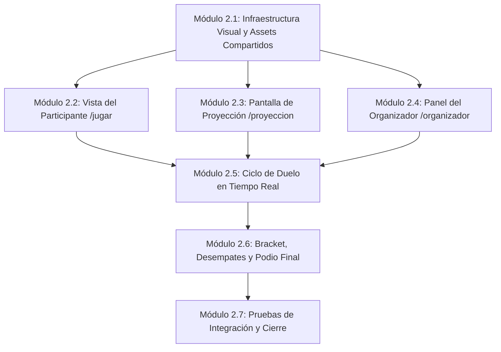

# PLAN TÉCNICO Y HOJA DE RUTA — FASE 2: INTERFACES MULTIJUGADOR EN TIEMPO REAL
## Proyecto: Torneo del Talento

**Fecha de elaboración:** 2026-11-18  
**Estado:** Planificación técnica para revisión y aprobación  
**Objetivo:** Desarrollar las interfaces web interactivas en tiempo real para Participantes, Pantalla de Proyección y Organizador, conservando la identidad estética de ingeniería (esmeralda y oro) y la dinámica ágil de Kahoot en duelos 1 vs 1.

---

## 1. DIAGNÓSTICO DEL ESTADO ACTUAL (BACKEND Y RUTAS)

### 1.1 Rutas y Vistas Existentes (`src/routes/viewRoutes.js`)
Actualmente las rutas devuelven plantillas mínimas de marcador de posición (*placeholders*):
- `GET /original` ➔ Sirve el archivo intacto `Torneo_Talento.html` (referencia canónica).
- `GET /jugar` y `GET /unirse` ➔ Vista de marcador de posición del participante con detección de `?code=XXXX`.
- `GET /organizador` y `GET /admin` ➔ Vista de marcador de posición del organizador.
- `GET /proyeccion`, `/proyeccion/:code` y `/presentacion/:code` ➔ Vista de marcador de posición de pantalla gigante.
- `GET /` ➔ Redirige a `/organizador`.

### 1.2 Endpoints REST Disponibles (`src/routes/apiRoutes.js`)
- `GET /api/health` ➔ Estado del servidor, memoria, latencia de PostgreSQL y preguntas cargadas.
- `POST /api/tournament/create` ➔ Crea un nuevo torneo, genera código único (ej. `TAL482`), persiste en PostgreSQL y devuelve `joinUrl` y `qrCode` (DataURL Base64).
- `GET /api/tournament/:code/qr` ➔ Genera el código QR del torneo en PNG o SVG.

### 1.3 Eventos de Socket.IO Existentes (`src/socket/socketServer.js`)
El servidor cuenta con autorización estricta en `socket.data` y los siguientes eventos:
- `join_participant`: Registra o reconecta un jugador mediante `{ code, name, rawToken }`. Emite `lobby_updated`.
- `join_projection`: Conecta la pantalla de proyección a la sala `{ code }`. Emite `projection_state`.
- `auth_organizer`: Valida la clave administrativa `{ code, adminSecret }`.
- `organizer_start_tournament`: Construye el cuadro de eliminación (*bracket*) y arranca el torneo. Emite `tournament_started`.
- `submit_answer`: Valida anti-spoofing, calcula puntuación autoritativa (tiempo + acierto) y emite `answer_acknowledged` (sin revelar la respuesta).
- `disconnect`: Detecta desconexiones individuales o simultáneas y activa la política de gracia de 30 segundos (`duel_player_disconnected`, `duel_both_disconnected`, `duel_grace_expired`).

### 1.4 Brechas Detectadas (Lo que falta en Backend para cerrar el ciclo completo)
Para que el frontend pueda operar sin fricciones, el backend necesita complementar el ciclo de vida del duelo:
1. `organizer_start_match`: Evento para activar un enfrentamiento específico del cuadro (`matchId`).
2. `organizer_launch_question`: Selecciona la siguiente pregunta (`pickQuestion`), prepara la versión sanitizada para clientes (`sanitizeQuestionForClient`) y emite `question_started` a la sala con `startTime` y `durationMs`.
3. `organizer_reveal_answer`: Cierra la recepción de respuestas, emite `question_revealed` con la respuesta correcta, la explicación, los puntos obtenidos por cada jugador y los marcadores actualizados.
4. `organizer_finish_match`: Determina el ganador del duelo, avanza al ganador en el cuadro (`advanceWinner`) y emite `match_completed`.
5. `organizer_finish_tournament`: Calcula el podio final (1.º, 2.º y 3.º puesto) y emite `tournament_finished`.

---

## 2. ARQUITECTURA DEL FRONTEND

```
src/
├── public/
│   ├── css/
│   │   ├── theme.css             # Variables CSS (esmeralda, oro, tipografías, tarjetas Kahoot)
│   │   ├── common.css            # Estructura base, modales, toasts, animaciones
│   │   ├── participant.css       # Estilos específicos de vista móvil (/jugar)
│   │   ├── projection.css        # Estilos para pantalla gigante 16:9 (/proyeccion)
│   │   └── organizer.css         # Panel administrativo con pestañas y controles
│   ├── js/
│   │   ├── audio.js              # Efectos de sonido con Web Audio API (ok, bad, win, countdown)
│   │   ├── confetti.js           # Celebración de podio con canvas nativo
│   │   ├── socket-client.js      # Wrapper de Socket.IO con reconexión automática y token storage
│   │   ├── participant.js        # Lógica del cliente participante
│   │   ├── projection.js         # Lógica de la pantalla de proyección y render del bracket
│   │   └── organizer.js          # Lógica del panel del organizador
│   └── favicon.ico
└── views/
    ├── participant.html          # HTML servido en /jugar
    ├── projection.html           # HTML servido en /proyeccion
    └── organizer.html            # HTML servido en /organizador
```

### Principios de Diseño:
- **Cero dependencias pesadas en cliente:** JavaScript nativo modular (ES Modules o IIFE ligeros) y Socket.IO Client CDN/local. No se requiere React, Vue ni empaquetadores como Webpack/Vite que aumenten el peso o compliquen el despliegue en EasyPanel.
- **Audio Nativo:** Sintetizador de frecuencias con Web Audio API portado de `Torneo_Talento.html` (no requiere archivos `.mp3` externos que fallen por latencia o bloqueo del navegador).
- **Mobile First en `/jugar`:** Botones grandes tipo tarjeta táctil con colores distintivos (`#d9573c` rojo, `#2f6fd6` azul, `#d99a1e` amarillo, `#1f9a72` verde), optimizados para dedos y feedback háptico/visual inmediato.
- **Full HD / 4K en `/proyeccion`:** Vista panorámica diseñada para verse con nitidez desde el fondo del auditorio.

---

## 3. IDENTIDAD VISUAL Y DESIGN TOKENS

Se preserva la paleta de colores y el estilo de ingeniería esmeralda y oro de `Torneo_Talento.html`:

```css
:root {
  /* Fondo y contraste */
  --bg: #0a302b;           /* Verde esmeralda oscuro de ingeniería */
  --bg-dark: #04130f;      /* Fondo profundo para tarjetas y paneles */
  --bg-duel: #11234d;      /* Azul tensión durante el enfrentamiento */
  --bg-podium: #241a44;    /* Violeta victoria para el podio */
  
  /* Textos y acentos */
  --mist: #eef4f1;         /* Blanco menta claro para títulos principales */
  --sage: #a9c7bb;         /* Verde salvia para subtítulos y metadatos */
  --gold: #f2a93b;         /* Oro brillante para acentos y marcas */
  --gold-2: #ffcf7a;       /* Oro claro interactivo */
  
  /* Botonera de juego estilo Kahoot */
  --c0: #d9573c;           /* Rojo coral (Triángulo / Opción A) */
  --c1: #2f6fd6;           /* Azul cobalto (Rombo / Opción B) */
  --c2: #d99a1e;           /* Amarillo dorado (Círculo / Opción C) */
  --c3: #1f9a72;           /* Verde esmeralda (Cuadrado / Opción D) */
  
  /* Indicadores de resultado */
  --ok: #2fa37f;           /* Verde acierto */
  --bad: #e0714f;          /* Naranja rojizo error */
  
  /* Tipografía */
  --f-head: "Archivo", system-ui, -apple-system, sans-serif;
  --f-mono: "IBM Plex Mono", ui-monospace, Consolas, monospace;
}
```

---

## 4. DIVISIÓN DEL TRABAJO EN MÓDULOS DE IMPLEMENTACIÓN



---

### Módulo 2.1: Infraestructura Visual, Assets y Rutas Limpias
- **Objetivo:** Crear la estructura de carpetas estáticas (`src/public/` y `src/views/`) y actualizar `src/routes/viewRoutes.js` para servir archivos HTML estáticos en lugar de cadenas inline.
- **Entregables:**
  - `src/public/css/theme.css`: Definición de tokens y variables.
  - `src/public/js/audio.js`: Módulo de audio con Web Audio API (`beep('ok')`, `beep('bad')`, `beep('win')`, cuenta regresiva).
  - `src/public/js/confetti.js`: Animación de confeti de victoria en `<canvas>`.
  - Actualización de `src/app.js` para servir `/public` de forma optimizada con caché controlada.
- **Criterio de Aceptación:** Las rutas `/jugar`, `/proyeccion` y `/organizador` sirven sus respectivos archivos HTML sin errores 404 ni bloqueos de CSP.

---

### Módulo 2.2: Interfaz del Participante (`/jugar`)
- **Objetivo:** Construir la experiencia completa en el teléfono móvil del concursante.
- **Estados de la Interfaz:**
  1. **Pantalla de Ingreso:** Entrada de código de torneo (pre-llenado automático si viene en URL `?code=XXXX`) y nombre de participante con sanitización en vivo.
  2. **Sala de Espera (Lobby):** Confirmación de registro, avatar o distintivo, y lista de compañeros en espera con actualización instantánea mediante `lobby_updated`.
  3. **Persistencia de Sesión:** Almacenamiento seguro de `rawToken` y `participantId` en `sessionStorage` para reconectar sin perder datos si se refresca la página o se interrumpe la red.
  4. **Pantalla de Espectador Activo:** Cuando el participante no está en el duelo actual, ve el estado de la partida, a quién le toca jugar y los puntajes.
  5. **Botonera de Respuesta en Duelo:**
     - *Opción múltiple:* 4 botones grandes de colores con símbolos geométricos (▲, ◆, ●, ■).
     - *Verdadero o falso:* 2 botones gigantes (Verdadero en azul/verde, Falso en rojo).
     - *Ordenamiento interactivo:* Fichas táctiles arrastrables o clicables para ordenar secuencias.
     - *Cálculo numérico:* Teclado numérico con coma/punto y botón de envío.
  6. **Feedback Inmediato:** Al enviar respuesta, la botonera se bloquea y muestra "Respuesta recibida en X.X s", manteniendo el misterio hasta que el servidor revele el resultado.
  7. **Pantalla de Revelación:** Acierto o fallo, puntos ganados y explicación breve.
- **Criterio de Aceptación:** Un jugador puede registrarse desde el celular, recargar la página y seguir conectado en la misma sala sin duplicarse.

---

### Módulo 2.3: Pantalla de Proyección (`/proyeccion`)
- **Objetivo:** Interfaz de alto impacto visual para la audiencia y la pantalla principal de la sala.
- **Componentes:**
  1. **Lobby de Bienvenida:**
     - Código de sala en texto gigante con alta legibilidad.
     - Código QR generado dinámicamente con `PUBLIC_URL` para escaneo directo con cámara móvil.
     - Contador en tiempo real y cuadrícula animada con los nombres de los jugadores que se van uniendo.
  2. **Visualizador del Cuadro (Bracket Interactivo):**
     - Representación gráfica de todas las rondas (Cuartos, Semifinales, Final y Tercer Puesto).
     - Resaltado en dorado del enfrentamiento activo.
     - Nombres tachados para eliminados y fondo dorado para vencedores.
  3. **Escenario de Duelo 1 vs 1:**
     - Encabezado con los dos contrincantes frente a frente ("Jugador A vs Jugador B") y sus marcadores acumulados.
     - Indicador visual de quién ya respondió (ej. tilde verde o borde parpadeante) sin mostrar qué opción marcó.
     - Pregunta gigante en pantalla con temporizador de barra horizontal y dígitos en cuenta regresiva.
  4. **Pantalla de Podio:**
     - Escalones animados con animación de entrada (1.º, 2.º y 3.º puesto).
     - Despliegue de nombres, puntajes finales y premios configurados.
     - Lluvia de confeti y fanfarria sonora.
- **Criterio de Aceptación:** La pantalla de proyección muestra el código QR nítido, los nombres actualizándose en vivo y el bracket escalando adecuadamente en resolución 1080p y 4K.

---

### Módulo 2.4: Panel del Organizador (`/organizador`)
- **Objetivo:** Proporcionar al maestro de ceremonias o docente el control absoluto del evento.
- **Funcionalidades:**
  1. **Creación de Torneo:**
     - Formulario con nombre del evento, preguntas por duelo (1 a 5), segundos por pregunta (10 a 45s), premios y dificultad.
     - Autenticación con `ADMIN_SECRET`.
  2. **Control de Sala de Espera:**
     - Botón "Iniciar Torneo" habilitado únicamente cuando hay 2 o más participantes.
     - Posibilidad de expulsar participantes con nombres inapropiados.
  3. **Control del Duelo:**
     - Botón "Lanzar Pregunta".
     - Botón "Revelar Respuesta".
     - Botón "Siguiente Pregunta / Siguiente Duelo".
     - Botón "Pausa de Emergencia" (detiene el temporizador en caso de imprevisto en la sala).
  4. **Historial de Preguntas:** Visualización del banco de preguntas, filtros por categoría y verificación de preguntas usadas.
- **Criterio de Aceptación:** El organizador puede crear un torneo, iniciar los duelos a su propio ritmo y pausar o avanzar las preguntas con retroalimentación inmediata.

---

### Módulo 2.5: Orquestación del Flujo de Duelo en Tiempo Real
- **Objetivo:** Integrar el ciclo de eventos de Socket.IO entre Participantes, Proyección y Organizador.
- **Ampliaciones Puntuales en `src/socket/socketServer.js`:**
  - `organizer_start_match`: Selecciona el duelo activo en el room y notifica a la proyección y a los 2 jugadores.
  - `organizer_launch_question`: Selecciona pregunta del banco, emite versión sanitizada a los jugadores y versión completa a la proyección.
  - `organizer_reveal_question`: Cierra recepción, calcula resultados, revela la opción correcta y actualiza marcadores.
  - `organizer_next_match`: Avanza al siguiente duelo del bracket o activa desempate (muerte súbita) si hay empate.
- **Criterio de Aceptación:** Al presionar "Lanzar Pregunta", los dos competidores ven la pregunta al mismo tiempo en sus teléfonos, el temporizador corre sincronizado en la proyección y el servidor bloquea las respuestas tardías de forma autoritativa.

---

### Módulo 2.6: Desempates, Tercer Puesto y Podio Final
- **Objetivo:** Manejar las excepciones competitivas y la ceremonia de cierre.
- **Lógica:**
  - Si un duelo termina empatado, se activa automáticamente la **Muerte Súbita**: una pregunta adicional por jugador a mayor dificultad hasta desempatar.
  - Generación automática del duelo por el **Tercer Puesto** entre los dos perdedores de semifinales.
  - Cierre del torneo y emisión del evento `tournament_finished` con el podio completo para activar animaciones en la proyección.
- **Criterio de Aceptación:** Un torneo con 4 jugadores resuelve semifinales, disputa el tercer puesto, resuelve la final y muestra a los 3 ganadores en el podio.

---

### Módulo 2.7: Pruebas de Integración y Simulación Multijugador
- **Objetivo:** Garantizar que el sistema soporte partidas reales sin errores de sincronización.
- **Pruebas:**
  - Simulación de 8 sockets en paralelo (navegador y scripts de test) jugando un torneo completo.
  - Prueba de reconexión durante el duelo (recargar el navegador a mitad de pregunta).
  - Verificación del periodo de gracia de 30 segundos si ambos jugadores pierden conexión.
- **Criterio de Aceptación:** 0 caídas del servidor, persistencia completa en PostgreSQL y 100% de coherencia en los puntajes.

---

## 5. DEPENDENCIAS Y COMPATIBILIDAD

| Componente | Dependencia / Versión | Justificación |
|---|---|---|
| **Librería de Sockets Cliente** | `socket.io.min.js` (v4.7.5) | Mismo protocolo que el servidor. Se sirve localmente desde `/socket.io/socket.io.js` provisto por el backend. |
| **Generación de QR** | `qrcode` (npm existente) | Ya instalado en backend; se reutiliza el endpoint `/api/tournament/:code/qr`. |
| **Framework CSS / JS** | Ninguno (Vanilla CSS + HTML5) | Rendimiento óptimo, carga instantánea en conexiones móviles lentas y cero dependencias externas. |
| **Fuentes Tipográficas** | Google Fonts (`Archivo`, `IBM Plex Mono`) | Mismas fuentes de `Torneo_Talento.html` con fallback a tipografías de sistema. |

---

## 6. ARCHIVOS QUE SE CREARÁN O MODIFICARÁN

| Archivo | Acción | Descripción |
|---|---|---|
| `src/views/participant.html` | Nuevo | Interfaz táctil y sala de espera del participante |
| `src/views/projection.html` | Nuevo | Pantalla gigante para proyector con QR, bracket y podio |
| `src/views/organizer.html` | Nuevo | Panel de administración y control maestro del torneo |
| `src/public/css/theme.css` | Nuevo | Paleta de colores, variables y diseño de tarjetas |
| `src/public/css/participant.css` | Nuevo | Maquetación móvil y botonera de juego |
| `src/public/css/projection.css` | Nuevo | Maquetación de alta resolución para auditorio |
| `src/public/css/organizer.css` | Nuevo | Estilos del panel de control |
| `src/public/js/audio.js` | Nuevo | Sintetizador de audio Web Audio API |
| `src/public/js/confetti.js` | Nuevo | Efecto visual de partículas en Canvas |
| `src/public/js/participant.js` | Nuevo | Controlador cliente de la vista participante |
| `src/public/js/projection.js` | Nuevo | Controlador cliente de la pantalla de proyección |
| `src/public/js/organizer.js` | Nuevo | Controlador cliente del organizador |
| `src/routes/viewRoutes.js` | Modificación | Cambiar placeholders para servir los HTMLs de `src/views/` |
| `src/socket/socketServer.js` | Modificación menor | Añadir manejadores para el flujo de duelos (`start_match`, `launch_question`, `reveal_question`) |
| `Torneo_Talento.html` | **INTACTO** | No se modificará bajo ninguna circunstancia |

---

## 7. RIESGOS TÉCNICOS Y MEDIDAS DE MITIGACIÓN

1. **Latencia y desincronización del cronómetro:**
   - *Mitigación:* El servidor es la única autoridad de tiempo (`startTimeServerTimestamp`). El cronómetro del cliente es meramente visual. Se mantiene el margen de gracia de red (`LATENCY_GRACE_PERIOD_MS = 800`).
2. **Reconexión durante una pregunta:**
   - *Mitigación:* Si un jugador recarga el navegador a mitad de un turno, el servidor reenvía el estado actual con el tiempo restante calculado matemáticamente (`durationMs - (now - startTime)`).
3. **Múltiples clics o respuestas repetidas:**
   - *Mitigación:* La botonera del participante se desactiva instantáneamente en el primer toque y el backend rechaza cualquier respuesta subsiguiente en memoria y en PostgreSQL.
4. **Filtración de respuestas antes de tiempo:**
   - *Mitigación:* `sanitizeQuestionForClient` elimina de raíz `correctAnswer` y `explanation`. Es imposible ver la respuesta correcta inspeccionando el código en el navegador del participante.

---

## 8. CONDICIÓN DE CIERRE Y PASO SIGUIENTE

> [!IMPORTANT]
> **Planificación completada.** En estricto cumplimiento de las reglas obligatorias:
> - No se ha modificado ningún archivo de código del backend ni de la base de datos.
> - `Torneo_Talento.html` se mantiene 100% intacto.
> - No se han realizado commits ni despliegues.
> 
> **Paso sugerido a autorizar:** Iniciar con el **Módulo 2.1 (Infraestructura Visual, Assets y Rutas)** y **Módulo 2.2 (Interfaz del Participante)**.
